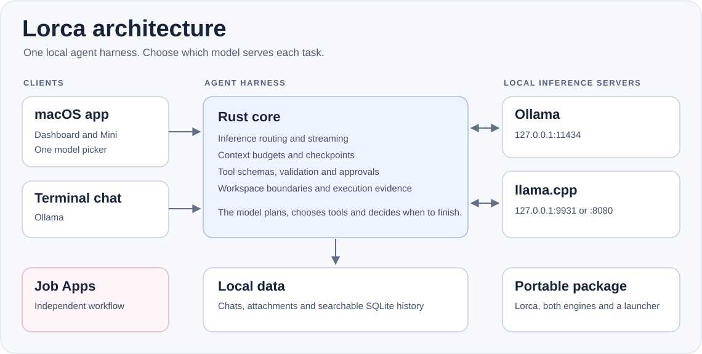

# 🌸 Lorca

Lorca is a model-agnostic AI agent for macOS, built in Rust 🫍. Its harness
manages inference, persistent memory, context, tools, and permissions. The
model reasons, plans, chooses tools, and decides when it’s done. Lorca adapts
to the hardware and carries work across model calls so a single context window
or generation budget doesn’t have to fit the whole task.

I started Lorca to learn how agent harnesses and local model runtimes work.
It grew into an agent I could use for my own work.

## Quick start

The [v0.5.0 GitHub release](https://github.com/lalithu/lorca/releases/tag/v0.5.0)
has the Apple Silicon app for use with an existing Ollama or llama.cpp server.

For one folder with the app and both runtimes, [build the portable ZIP from source](#build-from-source).
The portable build is ad-hoc signed for local testing. A public Mac download
needs Developer ID signing and notarization for the standard Gatekeeper flow.

Unzip the portable package and double-click **Start Lorca.command**. It reuses a
running server or starts bundled Ollama if neither server is available.

If you need a first model, run this in Terminal from the unzipped **Lorca** folder.
It downloads [Qwen3 4B](https://ollama.com/library/qwen3:4b) (about 2.5 GB) and opens the app.

```sh
./"Start Lorca.command" --ollama qwen3:4b
```

To use a GGUF you already have, run `./"Start Lorca.command" --gguf "/path/to/model.gguf"`.
Then pick the model in the composer. See the [portable setup guide](docs/portable-start.md)
for server ports and how to stop a server.

## What you can do

- Chat with streamed Markdown, images on compatible models, and local conversation history.
- Work in a selected folder with file reads, reviewable diffs, approvals and cancellation.
- Work across long tasks using searchable history, context checkpoints and output continuation.
- Export a conversation as Markdown or JSON.
- Research jobs, guide applications, create Gmail drafts and optionally sync with Google Sheets.

## Architecture



The Rust core routes requests to the model you select. The model chooses tools and
when to finish. Rust checks permissions, executes approved actions and records
what happened. [Architecture and four pillars](docs/architecture.md)

## Build from source

Install Rust and Xcode or Swift command-line tools. Use an Apple Silicon Mac to
produce the portable ZIP. The packaging script fetches pinned runtime archives,
verifies SHA-256 checksums and writes the ZIP and its checksum under `macos/build/`.

```sh
git clone https://github.com/lalithu/lorca.git
cd lorca
bash macos/package.sh
```

For day-to-day source development with your own model servers:

```sh
cargo install --path . --locked --force
lorca rebuild
lorca main
```

`lorca` opens terminal chat through Ollama. `lorca rebuild ui` rebuilds just the
native UI after a full build. Use `lorca rebuild` after Rust or bundle changes.
The base app requires macOS 14 or later. Job Apps requires Python 3.

## Upcoming work

- **MCP support** for connecting external tools and resources.
- **More robust native tools** for everyday workspace and agent workflows.
- **Leaner tool schemas** with clearer inputs and fewer tokens per declaration.
- **Broader runtime testing** across models and Apple Silicon Macs.

## Documentation

- [v0.5.0 release notes and validation](docs/releases/v0.5.0.md)
- [Runtime behavior and API contract](AGENT.md)
- [Tools and approvals](docs/tools.md)
- [macOS setup and controls](macos/README.md)
- [Job Apps setup and sync](jobapps/README.md)
- [Native acceptance checks](macos/Acceptance/README.md)

Chats, settings and Job Apps data live outside Git in macOS Application Support.
Optional Sheets sync is for Job Apps. Use a private Sheet for personal data.

[Apache 2.0](LICENSE) · [Third-party attribution](jobapps/vendor/NOTICE.md)
