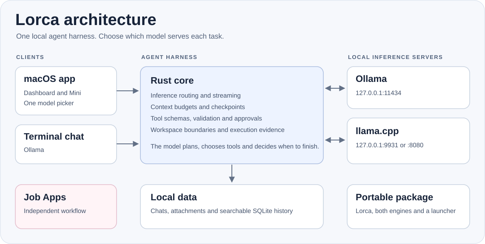

# 🌸 Lorca 🫍

Lorca is a native macOS app backed by a lightweight, model-agnostic Rust agent runtime. Run local models through Ollama or llama.cpp; the model owns reasoning, planning, and tool selection, while Lorca handles execution, permissions, saved history, and context management.

I started Lorca to learn how agent harnesses and local inference work. It grew into an agent for my own work.



## Current checkpoint

This branch focuses on main macOS chat: native tool calls, action approvals, streaming responses, model-generated context checkpoints, and history retrieval. Interrupted work is saved; actions are not automatically replayed after restart. Tasks currently stop when their client session closes or expires; unattended 24/7 execution is upcoming work.

Chats remain in `~/Library/Application Support/lorca/`. Readable journals and checkpoints are generated in `~/Downloads/lorca'sJournal/`; change the location in **Settings → Journals**. Private reasoning is not included in those journals. Raw transcript text may contain sensitive information.

Job Apps has its own pipeline. Notes following and hardware advice are deferred in this runtime checkpoint. The terminal chat interface is not supported by the replacement runtime.

## Start from source

Requires Rust and Xcode or Swift command-line tools. The native app requires macOS 14 or later. Start an Ollama or llama.cpp server, then run from the repository:

```sh
cargo install --path . --locked --force
lorca rebuild
lorca main
```

```sh
lorca main        # Open the macOS app
lorca rebuild ui  # Rebuild only the UI after a full build
lorca rebuild     # Rebuild the full app and restart
```

Pick your model in the composer. The [v0.5.0 release](https://github.com/lalithu/lorca/releases/tag/v0.5.0) is an older packaged version; it does not contain this runtime checkpoint. See the [portable build guide](docs/portable-start.md) for packaging instructions; the portable flow has not been revalidated for this rewrite.

## Validation

The checkpoint passed 19 focused Rust checks, the native Swift suite (138 tests, one skipped), and the packaged backend startup check. Legacy Rust tests still reference the retired runtime: the full test suite and CI need cleanup before a main-branch merge.

```sh
cargo test --locked --lib --test runtime_smoke --test context_management
bash macos/swift.sh test
```

## Upcoming work

- **Roster:** saved tasks with live local-run status. Save an objective, then choose **Run locally**; results, questions, and approvals use its linked chat. Tasks persist in `roster.json` alongside saved chats, and interrupted actions are never automatically replayed. The native Roster supports saved member profiles (Add, Edit, Remove), draggable cards, and saved layouts. Member connection settings are configuration only: frontier connectors, automatic planning, and scheduling are not implemented yet.
- Retire obsolete tests and dependencies, refresh CI, and improve tool usability and recovery.
- Separate durable task ownership from UI sessions for sustained background work.
- MCP and additional provider integrations. See the [roadmap](docs/roadmap.md).

## Documentation

[Documentation](docs/README.md) covers setup and supporting features. Some architecture and contributor documentation still describes the previous runtime and needs updating.

[Apache 2.0](LICENSE) · Built with [llama.cpp](https://github.com/ggml-org/llama.cpp), [Ollama](https://ollama.com/), Rust, and native SwiftUI/AppKit.
