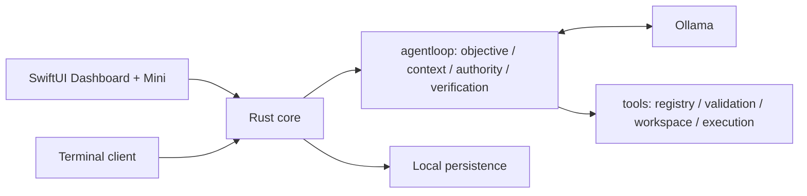

# 🌊 Lorca

A local-first AI workspace for macOS: native SwiftUI Dashboard and floating orca Mini, backed by one Rust core and Ollama.

## Features

- Streaming chat, Markdown, saved conversations, images and compatible-model vision.
- Workspace coding tools, live activity, diffs, exact-action approvals and cancellation.
- Task-scoped objective, context, authority and execution-based verification.
- Context/speed metrics, model selection, unload/reload and bounded quit cleanup.
- Job Apps research, guided applications, Gmail drafts and optional Google Sheets sync.
- Rust terminal chat alongside the native app; one shared backend.

## Architecture



## Build and run

Requires macOS 14+, Rust/Cargo, Xcode or Swift command-line tools, and Ollama with an installed model. Job Apps requires Python 3.

```sh
ollama pull qwen3.5:9b   # Keep Ollama running.
cargo install --path . --locked --force
./macos/build.sh
lorca main              # Dashboard; Mini is optional.
lorca                   # Terminal chat.
```

After installing, quit lorca and use `lorca rebuild` from any directory to rebuild the core, CLI and app, update the installed command, and open the dashboard.

## Repository

```text
src/
  agentloop/       Single runtime; objective, context, authority, verification
  tools/           Registry, native tools, workspace and command sandbox
  agent_types.rs   Shared protocol/tool types without runtime dependencies
  provider/        Ollama structured tool-call streaming
  core/            Sessions, conversations, model lifecycle and task association
  context.rs       Shared bounded context and compaction
  storage.rs       Atomic conversation/image persistence
  transport.rs     Authenticated loopback API
macos/             SwiftUI/AppKit views and app packaging
jobapps/           Python companion, local tracker and Google integrations
docs/              Detailed architecture and developer guidance
tests/             Deterministic Rust regression coverage
```

## Documentation

- [Architecture and four pillars](docs/architecture.md)
- [Runtime behavior, tools and API contract](AGENT.md)
- [macOS setup and controls](macos/README.md)
- [Job Apps setup, sync and limitations](jobapps/README.md)
- [Concise functionality reference](FUNCTIONALITY.md)
- [Native acceptance checks](macos/Acceptance/README.md)

Personal data lives outside Git under macOS Application Support. Optional Sheets sync contains personal Job Apps data; use a private Sheet. Credentials remain local. This personal build includes the author's Gmail address in its integration. Chat history does not sync through Sheets.

[Apache 2.0](LICENSE) · [Third-party attribution](jobapps/vendor/NOTICE.md)
