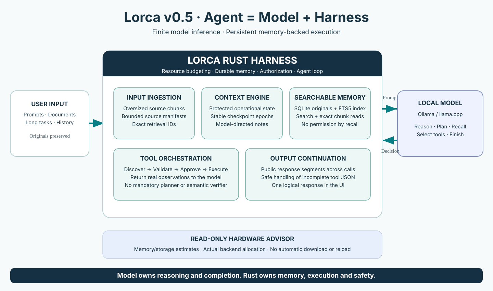

> Historical incoming handoff. The original failure list and draft JSONL design
> below describe the candidate before local hardening. Current architecture and
> test results are in [v0.5 validation](v0.5-validation.md). Do not merge or release
> without the owner's separate approval.

# Codex handoff — Lorca v0.5 release review, hardening, tests, and final delivery

You are working in the **actual repository** `lalithu/lorca`.

**Work on branch** `feat/v0.5-context-memory-foundation` (draft PR #2). **Do not modify or merge `main` or the release tag until all gates pass and I approve.**

Read first:
1. [Target architecture diagram](v0.5-architecture.svg), rendered below.
2. [Complete implementation architecture and phase plan](v0.5-architecture-plan.md).
3. [Full 228-file repository audit](v0.5-repository-audit.md).
4. `AGENT.md`, `docs/architecture.md`, `docs/tools.md`, `docs/releases/v0.4.0-nominal.1.md`.
5. **Every file changed** in PR #2, plus all tests and their affected entrypoints.



## Your mandate

Treat the current v0.5 branch as **a candidate implementation, not a passing or finished release**. Source edits were made through the GitHub connector in an environment without `cargo` or Swift compilation; you MUST compile, diagnose and correct any mistakes, and write additional tests. Do not simply produce another plan. Make and commit corrections on this branch, preserving the known-good v0.4 baseline and strict tool authorization.

Mission: **Agent = Model + Harness.** The model decides tools, plans, how to use memory, and semantic completion. Rust owns deterministic storage, context budgeting, provider interfaces, tool execution and safety. No mandatory planner, task-classifier LLM, Rust semantic task judge, vector service, cloud dependency, or arbitrary whole-task turn/output caps. Hardware-aware inference preparation comes **last**.

## Mandatory engineering pass

### 1. Build and regression baseline
```bash
git fetch origin
git switch feat/v0.5-context-memory-foundation
git status --short
cargo fmt --all
cargo fmt --all -- --check
cargo test --locked --all-targets --no-fail-fast
cargo clippy --locked --all-targets -- -D warnings
python3 -B -m unittest discover -s jobapps/tests
swift test --package-path macos
```
Build and launch the **native signed macOS app** and run existing acceptance/restart scripts. Record actual counts, platform, compiler versions, failing commands, and final resolution; never claim success without output. Check the new CI workflow; if Actions is disabled, do local validation.

### 2. Memory archive, journal, indexing, and restart
Review `src/memory.rs`, `src/memory/ingest.rs`, `src/tools/agent/history.rs`, `src/tools/registry.rs`, `src/storage.rs`, `src/core/agent_chats.rs`.
- Preserve exact source messages, attached-image metadata, native tool call/result correlation, and original tool outputs across compaction and restarts.
- Validate journal ownership, UUID/path confinement, atomic/append failure, permissions (0600), corrupted or torn trailing records, sync failure, cancellation and duplicate occurrence reconciliation.
- **Resolve scalability**: the draft uses an append-only JSONL journal with an in-memory string search, NOT the final indexed SQLite FTS5 archive. Decide whether to replace with a single efficient durable SQLite FTS5 index and on-demand source retrieval or a comparably compact solution; benchmark large transcripts, memory use, search latency, and incremental append. Do not add an embedding runtime without evidence.
- Confirm history IDs remain stable across restarts, callbacks, conversation reopens, and when the same user text appears twice. A restored record must not be mistaken for freshly verified tool execution.
- Verify archive is not shared across chats/custom restricted registries (Job Apps). Deleting chat removes all its sidecars. User-controlled export and privacy are honored.
- Integrate persistent history recovery for interrupted native tasks and identify any standalone CLI gaps explicitly.

### 3. Context checkpoints and model-managed working memory
Review `src/context.rs`, `src/context/budget.rs`, `src/agentloop/context.rs`, `src/tools/agent/compact_context.rs`, `update_plan`, `execution.rs`.
- Test 8K, 16K, 32K and 65K effective allocations, reserved output and calibration after real prompt usage.
- Verify stable checkpoint epochs, hysteresis, cache-prefix behavior, preservation of current user objective/corrections/permissions, and atomic assistant tool-call/result groups.
- Model may request `compact_context`, curate advisory `update_plan` notes and search older history; Rust must deterministically compact without model cooperation. Never recursively summarize prior summaries; never let historical data become system instructions.
- Reduce unnecessary repeated checkpoint/prompt rebuilding, excessive storage duplication and context churn.
- Verify no unsafe permission bypass is possible by truncating/virtualizing a long original instruction.

### 4. Oversized input, chunk-index retrieval, and long outputs
Review `src/core/agent_chats.rs`, `src/agentloop/runtime.rs`, `src/memory/ingest.rs`, history tools, provider adapters and UI.
- Run 30K-token and 100K-token source inputs against an 8K-context model. The system should accept, archive, manifest and retrieve all source chunks, without requiring manual user splitting. Include Unicode, nested code blocks, instructions in the middle, files, long followups and corrections.
- Pay special attention to **authority using full original instructions**, not just prompt excerpts, and full-source traversal for tasks requiring exhaustive coverage.
- Check remaining transport, draft, per-tool and HTTP body caps: distinguish necessary resource limits from arbitrary prompt limits.
- Test length-limited responses spanning 3–20 model requests, including live streaming and correct final saved text. The branch currently concatenates acknowledged public segments but does not guarantee semantic continuity or robust overlap deduplication; harden this.
- Incomplete native tool JSON must never execute. Hidden reasoning cannot be stitched verbatim; use observable state and bounded no-progress recovery. Support cancellation, user steering and crash recovery.
- Test both Ollama and llama.cpp endpoints (real services and simulated stop reasons).

### 5. Lightweight tool orchestration and completion
- Preserve existing adaptive `tool_search` registration, exact JSON schema validation, workspace sandbox, path/symlink confinement, single-use approval tokens and user denial semantics.
- Prove normal read-only history tools don't ask for write approval, and that discovery never grants capability.
- **Model owns task completion**. The v0.5 patch removed semantic completion gating and reports factual execution state. Separate any remaining old `Requirements` / `inspection` / `verification` code from execution authority; simplify or remove only with careful regression tests. Safety constraints remain mandatory.
- No arbitrary overall native-chat turn/output ceiling; maintain resource watchdogs and repeated-identical-no-progress guards. Do not force a second inference just to classify intent.
- Confirm custom Job Apps registry remains restricted and tests continue passing.

### 6. Native macOS experience
- Validate Chat, Mini, model picker, approval sheet, thinking panel, text selection, scroll, job dashboard and restart.
- Test `Export entire chat as Markdown/JSON`: JSON contains original messages, agent transcripts/events and embedded JPEG assets; Markdown is readable and explicit about separate attachments. Check empty chats, huge exports, malicious filenames, Unicode and denied access.
- Confirm tool-generated output segments are streamed as **one logical answer**, persisted and readable after restart, without duplication.
- Native model advisor should report real RAM/storage, installed Ollama metadata, llama.cpp measured min/max/effective memory and optional Hugging Face GGUF catalog. Estimates are not verified KV-cache fit; never auto-download or silently replace the selected model.

### 7. Hardware-aware preparation — final pass only
After memory/input/output/harness gates pass, review `src/hardware.rs`, `src/core/models.rs`, `ModelAdviceView.swift`.
- Verify physical/available memory and available-storage calculations on Apple Silicon; no false confidence from disk file size as an exact weight + KV estimate.
- Prefer llama.cpp's measured allocations. Verify actual allocated n_ctx after load, preserve manual context overrides and existing loaded-model leases.
- If implementing automatic safe context fitting, do not reconfigure shared servers silently; make changing allocations explicit and recoverable.
- Download suggestions may use Hugging Face/Unsloth/Ollama model metadata, but verify exact quantization size, license, tool-calling support and backend compatibility before recommending installation.

## Required scenario matrix

- 100, 500, 1,000-turn chats; long task with 100+ tools; repeated checkpoint epochs; exact message retrieval from beginning, middle and end.
- Interrupted tool call with no linked result; partial/unknown command exit; concurrent cancellation; denied patch; changed file after read.
- History containing prompt injection attempting to grant permissions; cross-conversation search query; deletion and export privacy.
- Three consecutive length stops with observable public progress must continue; identical repeated segments must stop with a clear no-progress diagnosis.
- Reasoning on/off under constrained output; provider HTTP failures/timeouts; no invented continuation of hidden reasoning.
- Large sources: first/middle/last instructions, deliberate contradictory quoted material, Unicode, images and numerous attachments.
- Runtime allocation changes / switching models / running low on RAM / disk exhaustion.
- Everything still works with restricted Job Apps custom registries.

## Deliverables

1. A **corrected, formatter-clean, clippy-clean, passing** implementation on this same branch, with modular small files and no unnecessary dependencies.
2. Updated comprehensive report documenting precise implemented architecture, code paths, invariants, resource behaviors, known limitations, tests and measured metrics.
3. Updated target diagram if the actual implementation differs; preserve `docs/v0.5-architecture.svg` as reviewable source.
4. Full test/benchmark transcript, including macOS native smoke and real local-model behavior; honest remaining risks.
5. A final PR summary comparing v0.4 to v0.5, explicit migration/rollback instructions, and a reproducible macOS build.
6. **Do not merge to main or tag/release v0.5 until all required gates pass and I explicitly approve.** When approved, create final release and merge in the requested order.

Do not report “done” based on green unit tests alone. Inspect actual model behavior. If an algorithm cannot guarantee correctness for weak models, make the limitation and fallback explicit; do not hide it by adding brittle Rust semantic heuristics.
