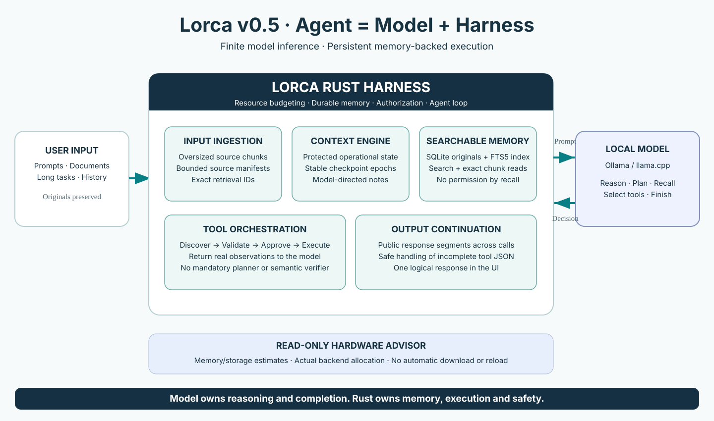

# Lorca v0.5 candidate architecture

**Agent = model + harness.** SwiftUI Dashboard/Mini and the terminal use the
same authenticated Rust core. `agentloop/` owns one active task, `tools/` the
native tool registry and handlers. Job Apps keeps its independent registry.

## One execution loop

1. Preserve original user input and prior observations in the conversation archive.
2. Build a bounded prompt: current objective/source manifests, current workspace,
   recent complete exchanges, operational facts and advisory working notes.
3. Ask the selected model using the actual allocated window where reported.
4. For native calls: validate arguments and workspace capabilities, enforce current
   user restrictions, obtain exact single-use approval where required, execute,
   archive the full observation, return its bounded projection with the same call ID.
5. Continue tool use, or continue a length-stopped public answer. A complete,
   tool-free public reply is the model's semantic stopping decision.

Rust does not infer whether the prose or requested feature is semantically correct.
`task_execution_status` reports unresolved operations and running commands. A
model cannot manufacture execution evidence by saying “done.” Missing command
exit status, denial, cancellation, no-progress loops and backend errors remain
explicit runtime states. A public clarification question is a valid reply;
`request_user_input` additionally creates an explicit waiting state.

## Four pillars remain

- **Objective:** original instruction and user corrections retained independently
  of their model-facing manifests.
- **Context:** finite projection with numbered checkpoint epochs, exact source IDs,
  current operational observations and model-authored advisory notes.
- **Authority:** trusted task restrictions, workspace capabilities, action digests,
  approvals and denials. Historical text never creates fresh authorization.
- **Verification:** actual file readback, command exit/status and factual observations.
  No generic semantic completion gate or forced “what next?” question.

Some legacy requirement/inspection helpers remain for scope constraints, audit APIs
and compatibility tests. They do not drive final-answer retries.

## Durable originals, bounded recall

`src/memory.rs` is the conversation-local SQLite facade (one connection shared by
that registry, a small SQLite page cache, no full archive Vec). Transactional
inserts update an external-content FTS5 index atomically. `synchronous=FULL` and
DELETE journaling keep recovery local; corruption and disk-full errors propagate.
There is no second model, vector database, embedding service or memory daemon.

Stable `hN` IDs refer to append-ordered records. Content, native call metadata and
attachment references are preserved; private reasoning and recalled excerpts are
excluded. `search_history` returns bounded literal-term FTS matches;
`get_history_record` pages Unicode scalar offsets or 2,048-character chunk indices.
The optional `field=metadata` pages original structured calls and attachments.
Search is token/phrase based, not semantic similarity or arbitrary substring search.

The draft JSONL archive is imported once in a transaction. Complete records before
an incomplete final line remain usable; that tail and the legacy file are retained.
Malformed complete records fail migration without a partial import. Existing
conversation JSON remains compatible. Occurrence reconciliation preserves repeated
identical messages; `hN` IDs are scoped to a single conversation. Archive paths are
UUID-scoped, files are mode 0600, and symlink destinations are rejected.

Explicit chat deletion removes the archive and sidecars. Existing independent
backups and user-created exports are not deleted. Explicit JSON/Markdown export
includes original records; JSON also embeds existing attachment files.

## Context, input and output

Context checkpoints start near 78% and target 60% of the allocation, further bounded
by the shared generation reserve. The prefix stays unchanged between checkpoints;
provider-reported prompt usage calibrates conservative token estimates. Complete
call/result groups remain atomic. A deterministic checkpoint is always available;
`update_plan` notes are advisory and `compact_context` can request an early epoch.
Recent facts are bounded in the prompt; full evidence and execution/denial caches
remain outside it. Older images may leave the prompt; their originals stay archived.

Oversized user text is archived before replacement by an ID/size/head/tail manifest.
The direct-input threshold shrinks for small context windows. Full original text
still determines authority, including restrictions buried inside a large correction.
Whole-source inspection uses sequential chunks and next offsets; the model owns
coverage and must not equate a snippet with exhaustive inspection.

`memory/continuation.rs` joins public length-stopped segments without invented
spacing. It suppresses exact echoes and conservative, bounded suffix overlaps,
including during streaming. Two consecutive non-advancing continuations stop with
partial work preserved. An empty final response gets one public-answer recovery;
it cannot silently turn a truncated partial answer into completion. Native argument
JSON is never stitched across requests or executed after a length stop. Specific
malformed-tool HTTP failures have a separate bounded recovery; unrelated server
errors do not retry as truncation.

A stopped backend does not automatically resume side effects. Saved conversation,
partial text, original records and explicit continuation remain available.

## Hardware and interfaces

The optional model advisor is read-only: reclaimable-memory/storage estimates,
installed Ollama metadata, actual reported context, and llama.cpp memory snapshots
where supplied. Online Hugging Face listing is opt-in. It does not rank model
quality, guarantee KV/vision fit, resize context, download or reload models.
Auto-detection prefers a healthy llama.cpp server with a nonempty catalog, otherwise
Ollama. The CLI still uses Ollama. No Job Apps workflow or unrelated UI is changed.

See [validation and limitations](v0.5-validation.md), [tools](tools.md), and
[AGENT.md](../AGENT.md) for commands and operational boundaries.
