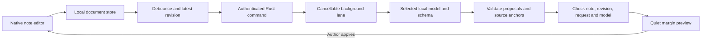

# Ems Notes: model-following architecture

Embedded Model Interfaces (Ems) keep the author's document as the interaction surface. Notes now connects to Lorca's Rust backend and the locally selected model. Full MCP integration is outside this implementation.

## Interaction

Write naturally. Following considers the note after a 1.5-second pause; no table keyword or special syntax is required. At most two proposals are returned, and the first applicable proposal appears as a quiet margin glyph. Click it to inspect a table, headings/lists, a reordered task list, or a prepared breakdown. Dismissal reveals any remaining proposal. No popover opens automatically.

The footer is **Model following**. Its menu exposes pause/resume, the current model and available local model choices, request status, and explicit refresh. Pausing survives restarts. A failed request does not trigger an automatic retry loop.

Applying a proposal is an explicit, undoable editor action. Tables use native text-table blocks; notes retain RTF alongside plain text. Breakdown content is added after its source; structure and priority proposals replace only their source passage. Cursor and scroll position are preserved where possible. Existing tables are protected from overlapping replacements in this iteration.

## Boundaries and ownership

- **NotesStore** owns durable text, rich table data, selection, last-open note, and pause preference. A model result cannot write directly to this store.
- **NotesFollowing** owns transient request state and proposal presentation. It observes the existing ChatStore model route; it does not create a separate model session or append messages to chats.
- **Rust Core** owns cancellation, foreground arbitration, model preparation and leases, budgets, and the response contract.
- **Provider adapter** sends schema-constrained requests to the selected Ollama or llama.cpp route. It receives no filesystem, terminal, email, image, web, or MCP tools.
- **Native editor** rechecks the exact full document and unique source passage before applying anything. No model output is evaluated as code.

## Latest revision and foreground priority

Every meaningful change advances the frontend request revision. Typing withdraws the old preview immediately, cancels the older task, and requests backend cancellation using the old request UUID. Rapid edits coalesce. Hidden Notes, pause, note switches, foreground work, model changes, and reconnects all invalidate pending work.

Responses carry note UUID, revision, request UUID, and model ID. The frontend checks all of them plus the original full document and current visible/paused state. Late responses are discarded even if the transport ignores cancellation.

The backend has one background notes lane. A newer revision cancels its predecessor. Foreground commands increment an admission counter, cancel notes, and drain only the background lane; they do not lock each other out. This preserves existing cancel-load and bounded-shutdown behavior. Once foreground work is established, Notes waits for a later eligible revision or explicit refresh. Backend session expiration cancels work owned by that session.

## Proposal contract

`notes_follow` accepts authenticated session, request UUID, note UUID, revision, bounded note text, and local timestamp/timezone. `notes_cancel` is scoped to session and optionally request UUID, so an old cancellation cannot stop a newer request.

The model returns at most two structured proposals. Supported kinds are `table`, `structure`, `priorities`, and `breakdown`. Each has an exact, unique source substring and a short title. Tables require headers and rectangular rows; other kinds require text. Rust rejects unknown fields/kinds, overlapping or missing source anchors, malformed/ragged tables, incomplete responses, and oversized output. The editor independently rejects sources intersecting an existing table.

The prompt tells the model to preserve user facts and uncertainty, leave missing values blank, interpret relative deadlines using the supplied local time, and return nothing when no useful proposal exists. These are model instructions, not guarantees of semantic correctness; the author reviews the preview.

The transport uses documented [Ollama structured outputs](https://github.com/ollama/ollama/blob/main/docs/capabilities/structured-outputs.mdx) and [llama.cpp schema-constrained responses](https://github.com/ggml-org/llama.cpp/blob/master/tools/server/README.md). Schema enforcement is supplemented by the application checks above.

## Context and performance

Inference runs in Rust, outside the native editing thread. Requests are debounced rather than sent per keystroke, use thinking-off generation, and have bounded output and a 75-second inference deadline. The provider response is byte-bounded. Model preparation uses the existing lifecycle and is drained on cancellation.

Short notes are supplied in full, up to a 12,000-byte frontend threshold. Longer notes supply a bounded, Unicode-safe passage near the cursor; the footer menu explicitly reports that reduced scope. This is not yet whole-notebook memory or a document-retrieval tool. Rust checks the estimated prompt plus schema against the allocated context window and refuses inputs that do not fit.

There is no background research, external information gathering, image generation, or email sending. A breakdown can prepare an outline from known context, and must not claim research or completed work. Those capabilities will need explicit tool interfaces in a later pass.

## Validation

Native tests cover rapid-edit coalescing, cancellation, late-result fencing, hidden/paused behavior, persistent pause, source uniqueness, Unicode context bounds, stale native replacements, saved notes, caret restoration, RTF tables, undo, and corrupt-file preservation.

Rust tests cover exact source validation, typed proposal schemas, cancellation/replacement, cross-session isolation, foreground preemption, and no chat/tool side effects. Existing core lifecycle regressions check that model cancellation, shared leases, and bounded shutdown still work. Live model checks use synthetic content in an isolated backend data directory.
