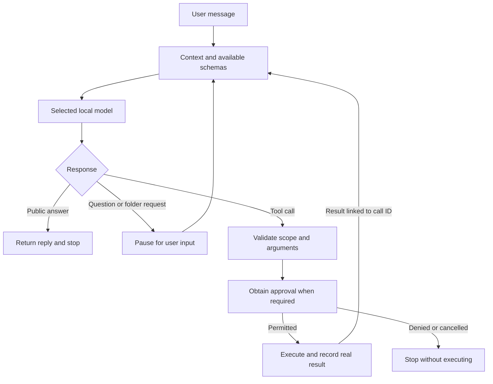

# Lorca v0.4.0-nominal.1 — Nominal checkpoint

This source release records the lightweight local-chat and adaptive-tool harness on main. “Nominal” names a usable development checkpoint; it does not certify every model, generated answer, or workflow as correct.

## What changed

- One native chat composer supports conversation and model-selected structured tool calls without a separate interpretation/routing generation.
- Native macOS chat supports an existing llama.cpp server, with Ollama available as the fallback. Model preparation remains lazy. The terminal CLI continues to use Ollama.
- Native thinking controls, reasoning display, response details, and context-window controls are included from the lightweight-chat branch. Native chat has no fixed turn cap; request timeouts and bounded recovery remain.
- A tool-free public answer stops the loop. The execution-evidence audit remains informational rather than forcing generic verification retries. Known unresolved action failures and unfinished command sessions are still reported.
- Conversation history keeps linked assistant tool calls and tool results for contextual follow-ups, including saved turns with no public text. Previous results remain context rather than permission or proof of newly executed work.
- A response with no public answer receives one recovery opportunity using the same context and tools, with thinking requested off where supported. Private reasoning is not relabeled as the public answer; another empty result ends with an explicit incomplete status.
- Without a workspace, the initial schemas are `tool_search`, `request_workspace`, and `request_user_input`. With a workspace, they are `tool_search`, `request_user_input`, `list_directory`, `read_file`, `search_files`, `apply_patch`, `exec_command`, and `write_stdin`.
- Configured `web_search` is initially visible in either state. Other capabilities stay discoverable. Follow-ups restore discovered schemas only for tools still registered in the current scope.
- Workspace handoff explicitly marks the selected folder active. File-tool descriptions distinguish browsing, reading, and searching; the search schema declares its nonempty-query constraint.
- Existing workspace boundaries, task restrictions, exact-action approvals, cancellation, and call-ID-linked results remain enforced. Job Apps keeps its independent workflow and registry.

## Harness flow

The Objective, Context, Authority, and Verification components retain the user's request, working context, permitted scope, and execution evidence. The model selects its next action; Rust executes permitted calls and supplies actual outcomes. Finishing the loop is distinct from proving the semantic correctness of an arbitrary generated artifact.

## Validation

- `cargo test --locked --offline --no-fail-fast`: 230 passed, 0 failed, 7 opt-in tests ignored.
- `cargo clippy --locked --offline --all-targets -- -D warnings`: passed.
- `cargo fmt --check` and `git diff --check`: passed.
- `DEVELOPER_DIR=/Applications/Xcode.app/Contents/Developer xcrun swift test --package-path macos --skip-build`: 106 existing built XCTest tests passed, 0 failed. This does not rebuild or recompile the current native UI.
- `python3 -B -m unittest discover -s jobapps/tests`: 111 passed.
- `python3 -B -m unittest discover -s macos/Tests/Restart`: 9 passed.
- The configured-web-search starter check also passed with a test-only search endpoint; it does not claim a live search-provider test.

Deterministic model/HTTP fixtures are distinct from live-model acceptance. No live-model benchmark, new visual acceptance, or macOS app-bundle rebuild is claimed. The application bundle is not attached to this source release; rebuild locally to run these source changes.

## Current limitations

- `exec_command` is restricted to approved, sandboxed Cargo verification commands. It is not a general shell; that work is deferred.
- Structured-call quality, exact-match patch accuracy, and thinking/public-answer separation still depend on the selected model and runtime. Recovery is bounded, not a guarantee that malformed output will become valid.
- Context and generation budgets remain finite. More initial schemas consume more prompt space: the retained-history integration fixture uses 6K instead of 4K. Essential-state overflow is reported explicitly rather than silently dropping the current request.
- Native chat has no fixed turn cap, but per-request timeouts, limits on calls per response, repeated-failure checks, and unproductive-planning safeguards still apply. CLI/API defaults may set a turn cap.
- Web search requires a configured working integration. Page fetching is not browser automation, and no Ocean browser is included.
- An informational evidence audit does not independently certify that a UI works or that all prose claims are correct.
- Existing runtime documentation still contains older stopping-rule and starter-schema descriptions. Use this release note and `docs/tools.md` for the current checkpoint; consolidate the remaining documentation next.

## What to improve next

1. Extend terminal execution deliberately: useful shell commands and process interaction through the existing authorization boundary, with clear command/cwd/output and cancellation behavior.
2. Benchmark real tasks on the models used on both Macs: success rate, incorrect tool choices, retries, public-answer delivery, latency, and tokens. Add targeted fixtures for observed failures rather than model-name routing rules.
3. Reduce prompt and retained-history overhead while preserving active instructions, linked tool results, and operational state; measure small-context behavior before changing limits.
4. Exercise long conversations, folder handoffs, provider switching, and reasoning-only responses in the current rebuilt native app. The source release does not claim fresh visual or live-model acceptance.
5. Add web search and browser capabilities as independent tools using the same registry, permissions, and result loop. Keep Job Apps independent.
6. Consolidate older architecture/runtime documentation around the actual stopping rules and current tool-exposure policy.
